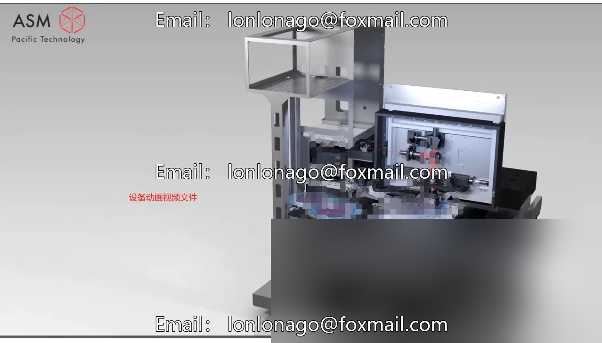
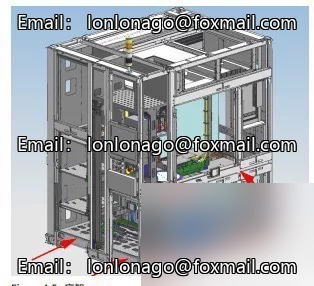
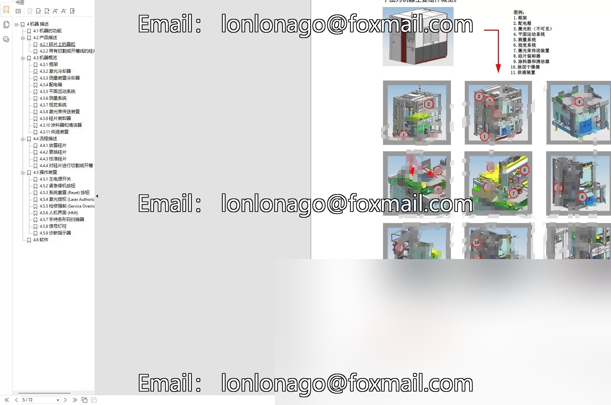
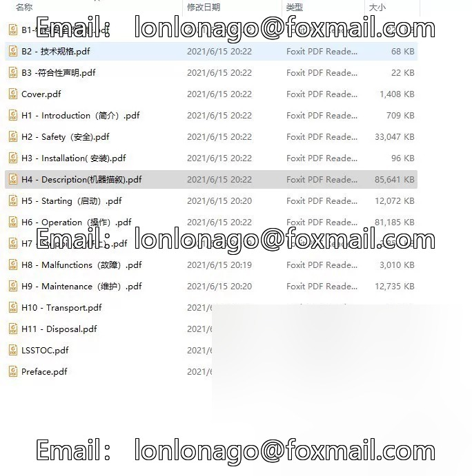
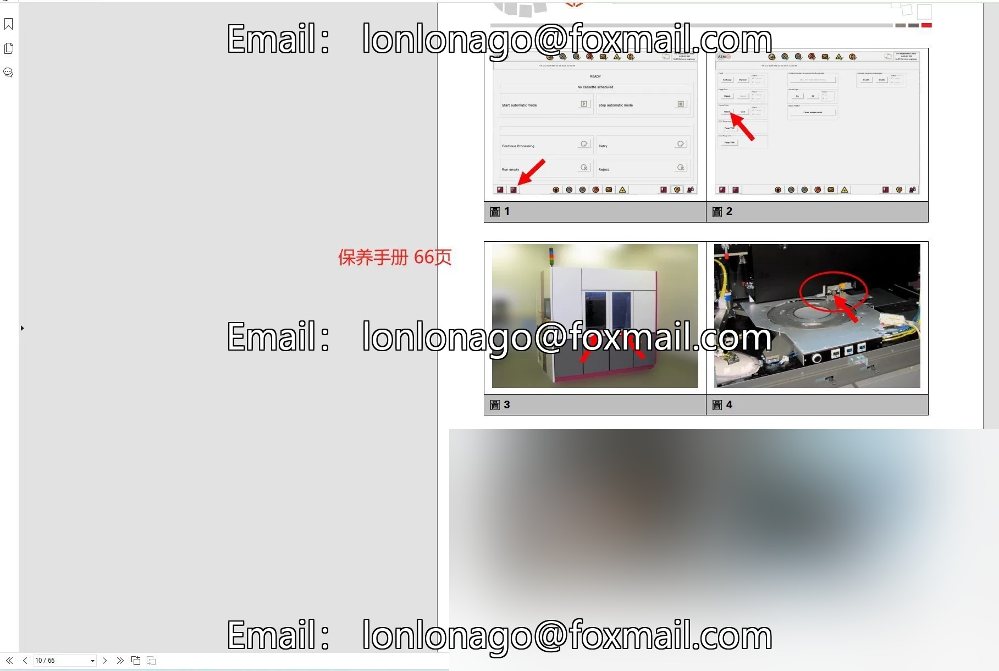
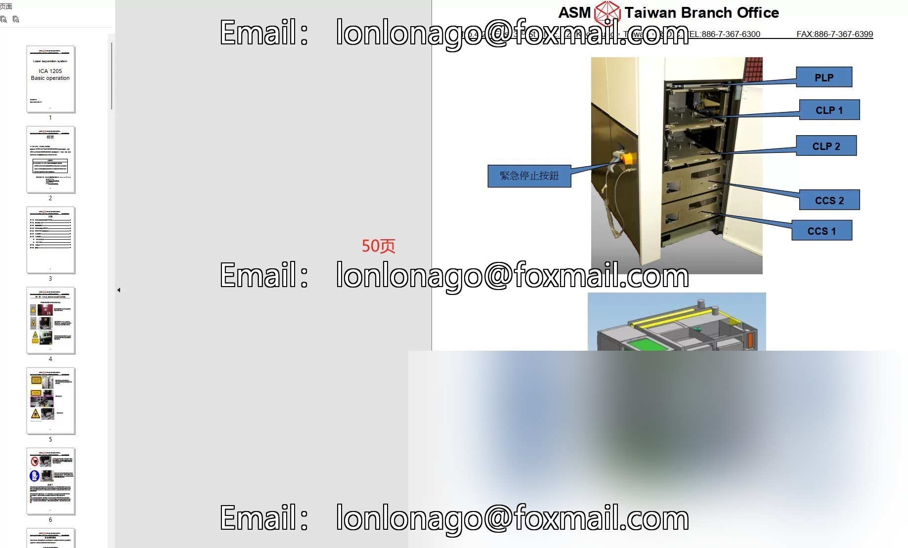
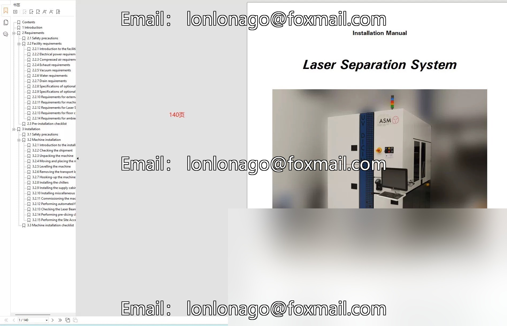
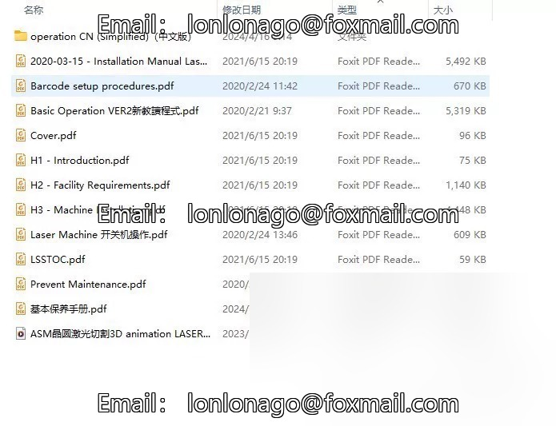

# Low-cost ASM wafer laser slicing machine materials

## Body

Low-cost ASM wafer laser slicing machine data

Materials include: maintenance and preservation manuals, operation manuals, and device animation video.

The equipment animation video is particularly clear, enabling clear recognition of equipment structure and movements.

Extremely scarce semiconductor materials

Take a photo and directly send the electronic original file

will not be refunded or exchanged once sold.

Confirm before placing an order~

Category:

The materials include maintenance and maintenance manuals, operation manuals, and device animation videos, along with detailed descriptions of equipment structure, functions and workflows.

<!-- AI_ENRICHED -->

## Images

## Payment

Here is a pay link on Stripe ( https://buy.stripe.com/3cs8yP7sY87d0vu9AB ). Please contact me lonlonago@foxmail.com after funding $89, and I will send you a complete data files , thank you!

